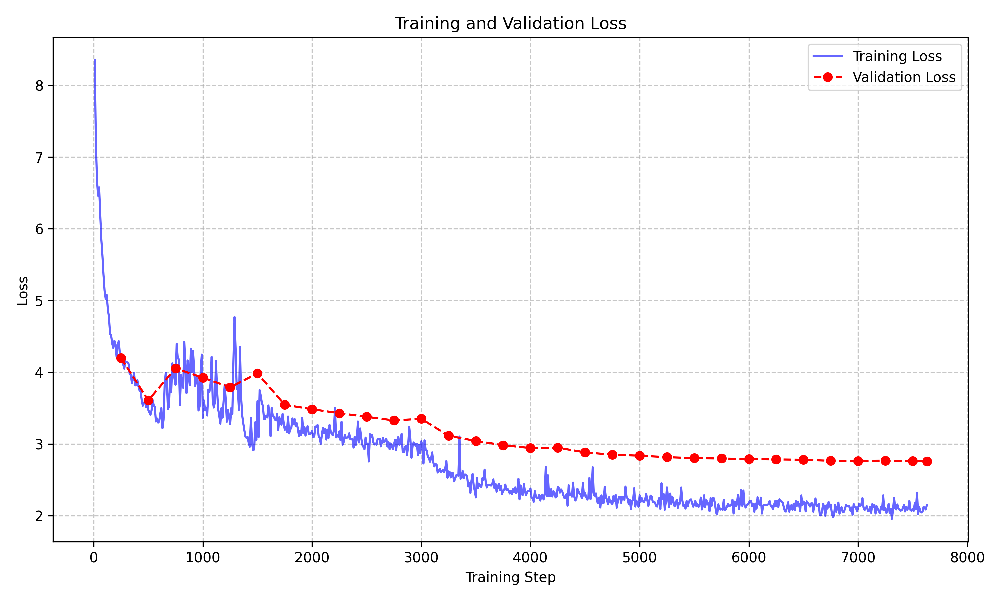
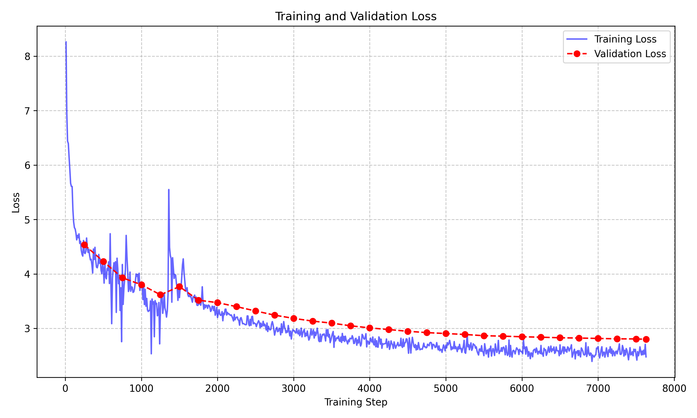
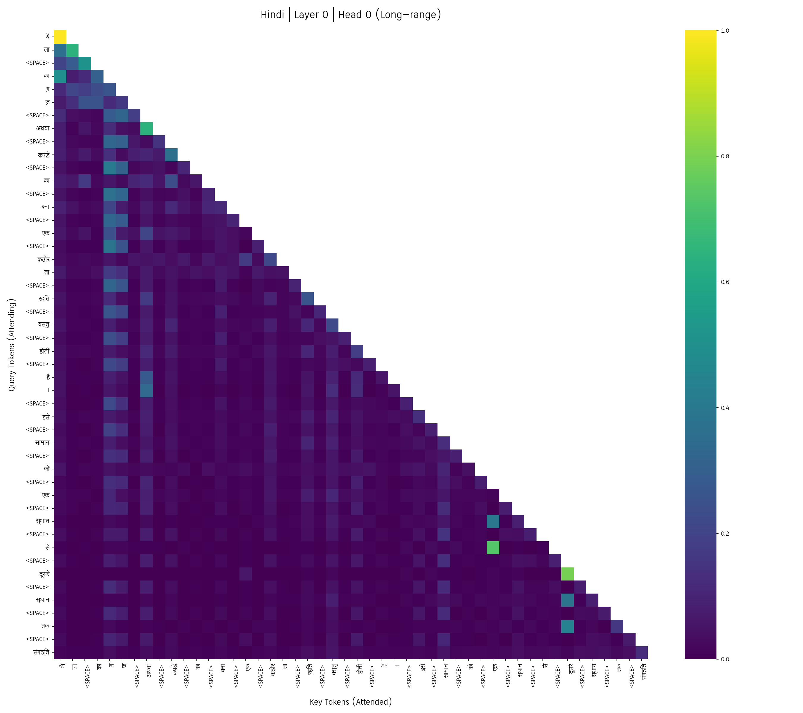
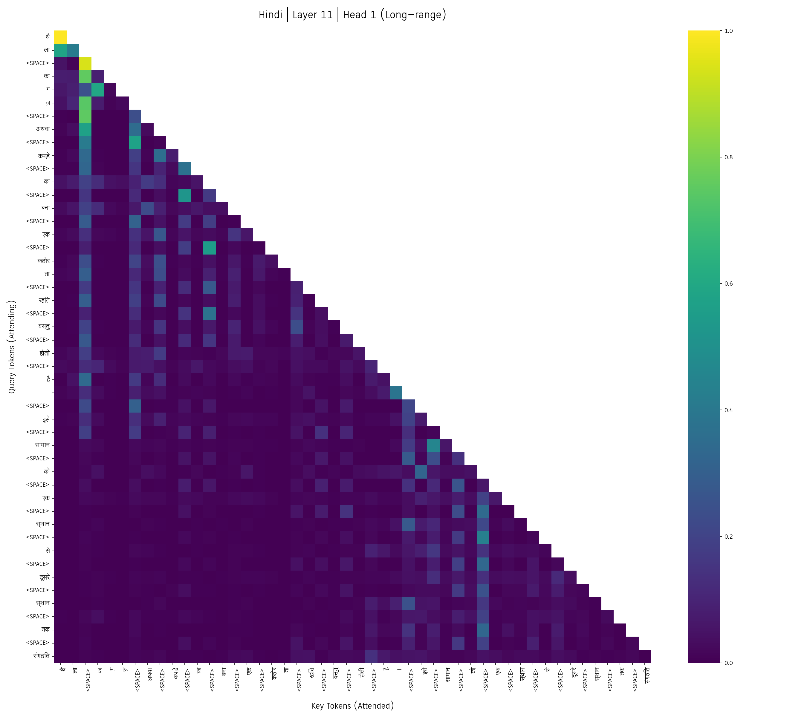
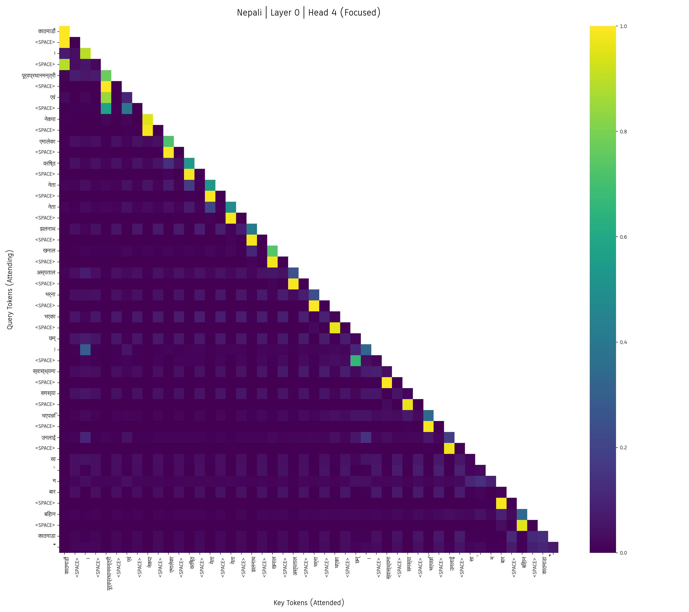
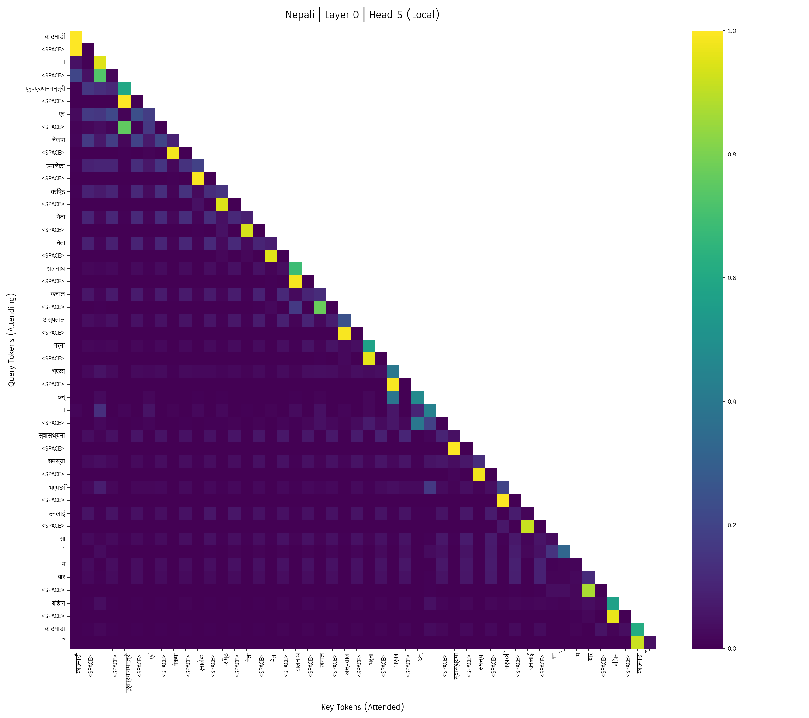
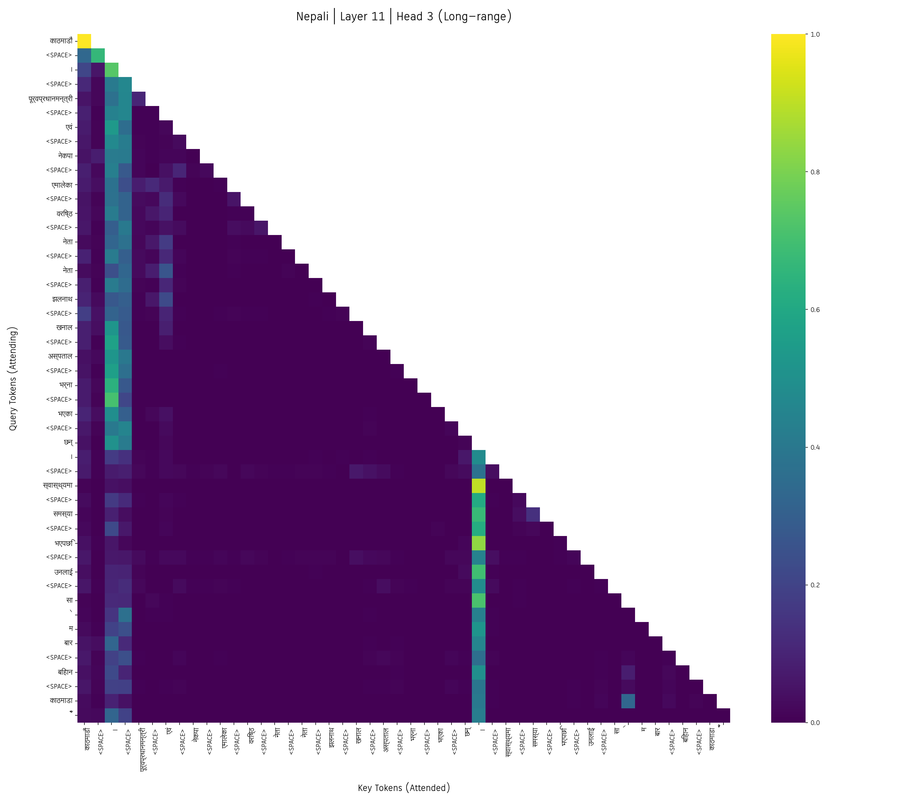

# Phase 2 - Written Analysis

## 1. Positional Embeddings
For both models (Hindi and Nepali), **Rotary Position Embedding (RoPE)** was used. 

**Why RoPE:** RoPE injects positional information into the self-attention mechanism by rotating the query and key representations at every layer. It is not an absolute positional embedding. This preserves relative positional information better.

**Constraint on Maximum Sequence Length:** In my implementation, the effective maximum sequence length is 512 tokens because the RoPE cosine/sine frequency tables are precomputed (and configured) up to `context_length = 512`, the causal mask is constructed strictly for this context length, and the model is trained on sequences up to this context window. RoPE itself can theoretically be extended beyond the training context using appropriate extrapolation methods, but such lengths are not supported by my current implementation and training setup.

## 2. Attention Scaling
Attention scores are divided by $\sqrt{d_k}$ (the square root of the head dimension) because the variance of the dot product ($Q \cdot K^T$) grows linearly with the head dimension $d_k$. Without this scaling, large dot products would push the softmax function into saturated regions where gradients are extremely small (leading to the "vanishing gradient" problem). Scaling by $\sqrt{d_k}$ ensures the variance remains close to 1 and this keeps gradients stable.

## 3. Empirical Causal Mask Verification
To empirically verify that the model cannot see future tokens, the following experimental procedure was performed during evaluation:
1. The model was set to evaluation mode and dropout was disabled.
2. An original sequence of tokens was passed through the model, and the output logits at position $t$ were recorded.
3. The future token at position $t+1$ was modified.
4. The modified sequence was passed through the model again.
5. The logits at position $t$ between the original and modified sequences were compared.
6. The actual observed maximum absolute difference from the experiment was reported as 0.0 (numerical zero within floating-point precision).
Since the maximum absolute difference is zero within floating-point precision, the test passes. Therefore, changing future tokens does not affect earlier logits, proving the causal mask correctly blocks access to future tokens.

## 4. Layer Normalization
The models use **Pre-LayerNorm** (Pre-Norm).
The architecture applies layer normalization before the self-attention and feed-forward sub-layers.

**Why Pre-Norm:** Pre-Norm is generally more stable for deeper Transformer stacks because it provides a clean, unmodified identity path for gradients to flow backward through the residual connections. This improved gradient flow reduces the likelihood of vanishing gradients and generally makes deep networks easier to train without complex learning rate warm-ups.

## 5. Dropout
To prevent overfitting, dropout (configured at a rate of 0.1) was explicitly applied in four locations:
1. **Embedding dropout:** Applied to the input token embeddings before entering the first transformer block.
2. **Attention probability dropout:** Applied to the attention probability weights after the softmax function inside the attention mechanism.
3. **Residual/output dropout after attention:** Applied to the output of the self-attention sub-layer right before it is added back to the residual stream.
4. **Residual/output dropout after FFN:** Applied to the output of the feed-forward network sub-layer right before it is added back to the residual stream.

## 6. Output Head and Weight Tying
The output head uses a linear projection that maps the model dimension to the vocabulary size ($d_{model} \rightarrow vocab\_size$) to produce the next-token logits.

**Weight Tying:** Yes, input-output weight tying was used (`tie_embeddings: true`). The output projection weights are tied to the input embedding matrix. By sharing this $10,000 \times 384$ matrix, exactly $3,840,000$ parameters are saved. (Note: the output projection retains its own separate bias vector of size 10,000, so the parameter savings come from the tied weight matrix). This reduces the memory usage and aligns the input token embeddings with the output class vectors.

## 7. Hyperparameters and Exact Parameter Counts

| Model | Vocabulary | $d_{model}$ | Layers | Heads | $d_k$ | FFN Dim | Context | Dropout | Exact Trainable Parameters |
|---|---|---|---|---|---|---|---|---|---:|
| Hindi Model H | 10,000 | 384 | 12 | 6 | 64 | 1536 | 512 | 0.1 | 25,190,400 |
| Nepali Model L | 10,000 | 384 | 12 | 6 | 64 | 1536 | 512 | 0.1 | 25,190,400 |

**Depth/Width Trade-off:**
Most of the training was carried out on Kaggle GPUs, while the local system was mainly used for development and testing.

A model dimension of 384 with 12 Transformer layers was chosen as a balance between model capacity and training cost. Increasing the model width would significantly increase the memory and computational requirements of both the attention and feed-forward layers. Instead, a moderate hidden dimension with more layers was preferred, allowing the model to learn increasingly complex representations across the Transformer stack without making the model too expensive to train.

---

# Phase 2 - Results

## 4.1 Training and Validation Loss Curves

These curves represent the training loss calculated over the training batches and epochs, and the validation loss calculated periodically on the validation split.

### Hindi Loss Curves

**Observation:** The Hindi model demonstrates clear convergence. Both training and validation loss decrease rapidly at first and then plateau. There is no significant divergence where validation loss increases while training loss drops, indicating that the model is not overfitting.

### Nepali Loss Curves

**Observation:** Similar to the Hindi model, the Nepali loss curves indicate stable convergence. The training and validation losses drop without exhibiting signs of severe overfitting or underfitting.

---

## 4.2 Intrinsic Evaluation

**Data Used:** The validation and test metrics were computed on the fully tokenised `val.jsonl` and `test.jsonl` splits 

### Hindi Intrinsic Metrics (Model H)
| Split | Cross Entropy | Perplexity | Bits Per Byte (BPB) | Total Predicted Tokens |
|-------|--------------|------------|--------------------|------------------------|
| Validation | 2.4411 | 11.4863 | 0.6383 | 14,176,544 |
| Test | 2.4565 | 11.6644 | 0.6441 | 14,397,392 |

### Nepali Intrinsic Metrics (Model L)
| Split | Cross Entropy | Perplexity | Bits Per Byte (BPB) | Total Predicted Tokens |
|-------|--------------|------------|--------------------|------------------------|
| Validation | 2.5288 | 12.5384 | 0.5207 | 12,929,769 |
| Test | 2.5265 | 12.5099 | 0.5206 | 12,859,213 |

### Tokenizer Efficiency Comparison

| Language | Split | Tokens per Word (Fertility) | Bytes per Token |
|----------|-------|----------------:|----------------:|
| Hindi    | Val   | 2.3735          | 5.5170          |
| Hindi    | Test   | 2.3782          | 5.5019          |
| Nepali   | Val    | 2.4482          | 7.0057          |
| Nepali   | Test   | 2.4494          | 7.0014          |

**Model H vs Model L Gap Discussion:** 
Model H (Hindi) achieves a slightly better perplexity (~11.6 on Test) compared to Model L (Nepali, ~12.5 on Test). The observed gap is likely influenced by a combination of factors:
* **Data Quality:** The Hindi dataset has a large proportion of manual, structured data (e.g., Wikipedia), which may provide a cleaner and more consistent linguistic signal than the scraped Nepali pool.
* **Tokenizer Fragmentation and Metric Differences:**  As shown in the efficiency table, Nepali has a higher fertility than Hindi, meaning that Nepali words are split into more subwords on average. This results in the same amount of text occupying more token positions, which can make modeling longer contexts more challenging and may partly contribute to Nepali Model L's higher perplexity. 

  However, the difference between the models is not identical across all metrics. Despite having worse perplexity, Nepali Model L achieves a better (lower) Bits Per Byte (BPB) score on the test set (0.5206 vs. 0.6441). Perplexity is calculated at the token level and is therefore strongly influenced by the tokenizer and how text is segmented into tokens, whereas BPB normalizes the negative log-likelihood by the number of UTF-8 bytes in the original text. Therefore, the higher PPL but lower BPB for Nepali shows that the apparent gap between the two models depends partly on the normalization used for evaluation and cannot be explained by perplexity alone.
---

## 4.3 Generation Quality Evaluation

**Data Used:** These metrics were calculated by generating 500 examples from `test.jsonl`. A prefix length of 64 tokens was used, and generation was capped at a maximum of 64 new tokens.

### Hindi Generation Metrics
| Config | BLEU | chrF | ROUGE-L | RepRate | Dist-1 | Dist-2 |
|--------|------|------|---------|---------|--------|--------|
| Greedy | 2.0919 | 13.4348 | 0.1121 | 0.6114 | 0.0701 | 0.2031 |
| Temp 0.5 | 2.0552 | 15.6424 | 0.1173 | 0.2071 | 0.1181 | 0.4261 |
| Temp 1.0 | 0.9423 | 15.6740 | 0.0872 | 0.0110 | 0.2257 | 0.8038 |
| Temp 1.5 | 0.0733 | 15.2115 | 0.0364 | 0.0000 | 0.2555 | 0.9660 |

### Nepali Generation Metrics
| Config | BLEU | chrF | ROUGE-L | RepRate | Dist-1 | Dist-2 |
|--------|------|------|---------|---------|--------|--------|
| Greedy | 1.8775 | 17.8625 | 0.0827 | 0.5008 | 0.1024 | 0.2906 |
| Temp 0.5 | 1.9386 | 20.4337 | 0.0935 | 0.1295 | 0.1672 | 0.5682 |
| Temp 1.0 | 0.7900 | 19.5160 | 0.0584 | 0.0045 | 0.2620 | 0.8716 |
| Temp 1.5 | 0.2056 | 18.3791 | 0.0299 | 0.0000 | 0.2851 | 0.9704 |

* **BLEU:** Limited for open-ended language modeling because many valid continuations may have little n-gram overlap with the single reference continuation.
* **ROUGE-L:** Also limited because longest-common-subsequence overlap with one reference does not capture the full space of valid continuations.
* **chrF:** Potentially somewhat more informative for Hindi and Nepali because character-level overlap is less sensitive to word segmentation, subword differences, and morphological variation than word-level n-gram metrics. However, chrF still cannot fully measure semantic correctness or the quality of alternative valid open-ended continuations.
* **Repetition Rate (RepRate):** Useful for detecting degenerate repetition and looping.
* **Distinct-1 / Distinct-2:** Useful for lexical diversity, but high diversity alone does not imply coherence or factual correctness.

---

## 4.4 Generated Samples

### Hindi — Example 1

**Prompt:** सुरेश नौ टिया ल ने बताया , ' इस मामले में सीधे तौर पर मुख्यमंत्री की भागीदारी है . किसी भी जमीन का हस्ता ं तरण का पट्ट ा बनता है . जब हम सब ने एसडीएम...

| Decoding Method | Generated Continuation |
|---|---|
| Greedy | को फोन किया तो उन्होंने कहा कि हम जमीन का हस्ता ं तरण नहीं करेंगे . हम जमीन का हस्ता ं तरण नहीं करेंगे . हम जमीन का हस्ता ं तरण नहीं करेंगे . हम जमीन का |
| Temperature = 0.5 | को बात की तो हम उन्हें पता चला कि इस मामले में सरकार की कोई कार्रवाई नहीं की गई है . ' उन्होंने कहा |
| Temperature = 1.0 | डें गू से दूरी खुल ानी शुरू कर दी तो हम जमीन का प्रा पर् श ड्यूटी में स्थानांतरित हुआ . अब यहां आने |
| Temperature = 1.5 | अप्र त्या खराब दाम पेशा ब सचि वा होटल उत्तराखंड विद्या ल लिका ओम प्रकाश , क एच उपहार बहा नील , अंधे |

### Hindi — Example 2

**Prompt:** गुजरात के सुर ेंद्र नगर जिले से बड़े पैमाने पर अवैध खनन चल रहा था । वहां पर 26 मशी नों का इस्तेमाल कर के 200 फीट की गहराई से खनन निकाला जा रहा...

| Decoding Method | Generated Continuation |
|---|---|
| Greedy | था । इस दौरान एक ट्रक ने एक ट्रक को टक्कर मार दी । इस दौरान एक ट्रक ने एक ट्रक को टक्कर मार दी । ट्रक ने एक ट्रक को टक्कर मार दी |
| Temperature = 0.5 | था । इसके बाद भी खनन के लिए दो कंपनियों का गठन किया गया था । इसमें से एक कंपनी को भी जब्त किया गया थ |
| Temperature = 1.0 | था । मगर , किस तरह से 500 की मात्रा में बा लू उपयोग में पाए जाने पर किसी तरह का जुर्माना लगाया जा सक |
| Temperature = 1.5 | था । राजधानी दृष्ट गायक अधिकांश क़ा अर प्रवर् छा वर माफिया 18 वाराणसी डै ली न संस्थानों की तमाम ह भर |

> The remaining 18 generated examples are available in `../hindi/eval/results/generated_samples.json`.

### Nepali — Example 1

**Prompt:** संविधानमा हुँदै नभएको अधिकारको व्याख्या गरेर निर्वाचनमा जान नमिल्ने तर्क गर्दै उनले ताजा जना देशमा जान का लागि प्रजातान्त्रिक र संवैधानिक अभ्यास हुनुपर्ने मा जोड दिए । २० ५२ मा तत्कालीन प्रधानमन्त्री मन मोहन अधिकारीले...

| Decoding Method | Generated Continuation |
|---|---|
| Greedy | संविधान जारी भएपछि संविधान जारी भएको थियो । तर संविधान जारी भएपछि संविधान जारी भएपछि संविधान जारी भएको थियो । संविधान जारी भएपछि संविधान जारी भएको थियो । संविधान जारी भएपछि संविधान जारी भएको |
| Temperature = 0.5 | राष्ट्रिय सभामा संविधान जारी गर्दा नै संविधान जारी भएको थियो । तर संविधान जारी हुँदा संविधान जारी भए |
| Temperature = 1.0 | ल्छन् - बन्दा बन्दी पछि महेन्द्र सिंह , राम शरण मह त , मान बहादुर खड्का लगायतले टि नको सामाजिक सञ्जा |
| Temperature = 1.5 | पार्टीलाई ट्रे टमा थि चिएको बहा नामा अन् यसरी हिरा सत मै काउ ण् टर , रिपोर् टर सेती गाउँपालिकाको रिय |

### Nepali — Example 2

**Prompt:** सन्धि खर्क , अर्घाखाँची ( अर्घाखाँची ड ट् कम ) । अर्घाखाँची जिल्लाको सदरमुकाम सन्धि खर्क स् ठ ित जिल्ला प्रहरी कार्यालयमा घुम् ती प्रशिक्षण अन्तर्गत भिड नियन्त्रण विशेष अनु शिक्षण तालिम समु द घाटन कार्यक्रम सम्पन्न भएको छ...

| Decoding Method | Generated Continuation |
|---|---|
| Greedy | । कार्यक्रममा जिल्ला प्रहरी कार्यालय अर्घाखाँची का प्रहरी नायब उपरीक्षक ( डिएसपी ) प्र दिप कुमार श्रेष्ठ , प्रहरी निरीक्षक ( डिएसपी ) प्र दिप कुमार श्रेष्ठ , प्रहरी निरीक्षक ( डिएसपी ) प्र दिप कुमार श्रेष्ठ , प्रहरी |
| Temperature = 0.5 | । कार्यक्रममा जिल्ला प्रहरी कार्यालय अर्घाखाँची को तर्फबाट प्रहरी निरीक्षक गणेश शर्मा , प्रहरी निरीक |
| Temperature = 1.0 | । म स्को मा वी पार् टि जे शन को तथा माइ कल जोन र्या म्मा ई व थ हल बर्ग मध्ये एक को होलान् , दुर्भाग् |
| Temperature = 1.5 | । पुनरा चल लु हरुको भाइरल um हतार मा अना बहादुर ख् ता प्रव न्ध क भोज प्र जन क्षेत्र ीले सहभागिता पश् |

> The remaining 18 generated examples are available in `../nepali/eval/results/generated_samples.json`.

**Qualitative Observations:**
* **Greedy:** Greedy decoding achieves good initial grammatical coherence but suffers heavily from degeneration. As evidenced by the actual outputs and the high `RepRate` metrics, the model quickly collapses into infinite looping structures (e.g., repeating "हम जमीन का हस्ता ं तरण नहीं करेंगे" or "प्र दिप कुमार श्रेष्ठ").
* **Temperature 0.5:** Introduces enough stochasticity to break the degenerate loops while maintaining strong grammatical correctness and semantic consistency with the prefix. The generated completions remain highly coherent and relevant.
* **Temperature 1.0:** Generates highly diverse outputs (supported by the high Distinct metrics) with no repetition. However, sentence completion begins to wander semantically, and some grammatical drift is noticeable as the model explores less likely token trajectories.
* **Temperature 1.5:** Excessive temperature destroys language coherence. The output devolves into a disjointed sequence of diverse but random vocabulary words lacking syntactic structure.

---

## 4.5 Attention Aggregate Metrics

**Data Used:** 500 documents were evaluated from the test set to aggregate the mean attention entropy and mean attention distance.

**Interpretation & Definitions:** 
* **Attention Entropy ($H = -\sum p_j \log(p_j)$):** 
  * Lower entropy $\rightarrow$ attention concentrated on fewer positions.
  * Higher entropy $\rightarrow$ attention distributed across many positions.
* **Mean Attention Distance:** The average absolute distance between the query position and attended key positions, weighted by attention probabilities.
  * Lower distance $\rightarrow$ more local attention.
  * Higher distance $\rightarrow$ more long-range attention.

### Hindi Attention Metrics
| Layer | Head | Mean Attention Entropy | Mean Attention Distance |
|-------|------|------------------------|-------------------------|
| 0 | 0 | 4.8631 | 23.8071 |
| 0 | 1 | 4.0674 | 19.7512 |
| 0 | 2 | 3.3833 | 16.3560 |
| 0 | 3 | 4.0395 | 18.1888 |
| 0 | 4 | 3.6396 | 16.1275 |
| 0 | 5 | 3.5663 | 19.0405 |
| 1 | 0 | 4.9045 | 22.6561 |
| 1 | 1 | 4.8294 | 21.6265 |
| 1 | 2 | 3.6908 | 11.6802 |
| 1 | 3 | 4.1398 | 12.7819 |
| 1 | 4 | 4.1731 | 17.7750 |
| 1 | 5 | 2.5773 | 9.4005 |
| 2 | 0 | 4.5391 | 19.0866 |
| 2 | 1 | 4.7866 | 20.9133 |
| 2 | 2 | 3.5436 | 11.6675 |
| 2 | 3 | 4.4297 | 17.6660 |
| 2 | 4 | 3.1049 | 13.3276 |
| 2 | 5 | 4.0633 | 13.3835 |
| 3 | 0 | 4.2452 | 19.1208 |
| 3 | 1 | 4.7614 | 21.9682 |
| 3 | 2 | 4.3263 | 26.9952 |
| 3 | 3 | 3.9364 | 15.4078 |
| 3 | 4 | 3.8647 | 15.8972 |
| 3 | 5 | 4.2239 | 17.8407 |
| 4 | 0 | 3.8372 | 16.9934 |
| 4 | 1 | 4.1831 | 20.2102 |
| 4 | 2 | 3.9027 | 13.7769 |
| 4 | 3 | 4.5023 | 21.8454 |
| 4 | 4 | 3.9177 | 16.6996 |
| 4 | 5 | 4.4750 | 20.9015 |
| 5 | 0 | 4.5798 | 19.8275 |
| 5 | 1 | 3.4700 | 10.1989 |
| 5 | 2 | 4.2130 | 18.1581 |
| 5 | 3 | 2.4196 | 5.2978 |
| 5 | 4 | 3.6791 | 12.5338 |
| 5 | 5 | 4.4808 | 19.7665 |
| 6 | 0 | 3.5029 | 13.5124 |
| 6 | 1 | 3.5072 | 30.7912 |
| 6 | 2 | 4.0004 | 17.9766 |
| 6 | 3 | 2.7403 | 12.7854 |
| 6 | 4 | 4.2902 | 22.5561 |
| 6 | 5 | 4.0808 | 18.7461 |
| 7 | 0 | 3.7136 | 12.5462 |
| 7 | 1 | 3.9110 | 26.2170 |
| 7 | 2 | 2.9788 | 35.6447 |
| 7 | 3 | 3.8696 | 17.4281 |
| 7 | 4 | 4.1229 | 25.4302 |
| 7 | 5 | 4.1527 | 30.2345 |
| 8 | 0 | 3.7087 | 16.6690 |
| 8 | 1 | 4.1945 | 21.4062 |
| 8 | 2 | 2.9890 | 8.8691 |
| 8 | 3 | 3.5474 | 16.6486 |
| 8 | 4 | 3.3083 | 12.1482 |
| 8 | 5 | 4.4593 | 24.5588 |
| 9 | 0 | 2.2937 | 5.7575 |
| 9 | 1 | 3.6608 | 19.1405 |
| 9 | 2 | 4.3189 | 25.8443 |
| 9 | 3 | 3.6142 | 18.4802 |
| 9 | 4 | 2.4668 | 8.5061 |
| 9 | 5 | 3.1238 | 12.2870 |
| 10 | 0 | 3.5046 | 15.4491 |
| 10 | 1 | 4.4276 | 23.1226 |
| 10 | 2 | 2.4946 | 9.3267 |
| 10 | 3 | 3.3030 | 11.3913 |
| 10 | 4 | 4.3348 | 23.8080 |
| 10 | 5 | 3.8523 | 16.9540 |
| 11 | 0 | 2.5427 | 9.9772 |
| 11 | 1 | 3.9311 | 20.3544 |
| 11 | 2 | 2.0754 | 5.7375 |
| 11 | 3 | 3.2845 | 10.2199 |
| 11 | 4 | 3.0542 | 10.4667 |
| 11 | 5 | 3.5883 | 15.1563 |

### Nepali Attention Metrics
| Layer | Head | Mean Attention Entropy | Mean Attention Distance |
|-------|------|------------------------|-------------------------|
| 0 | 0 | 4.4523 | 20.6659 |
| 0 | 1 | 3.5626 | 16.5007 |
| 0 | 2 | 3.1611 | 13.3176 |
| 0 | 3 | 3.6119 | 15.7802 |
| 0 | 4 | 2.9577 | 12.3562 |
| 0 | 5 | 2.8928 | 11.8831 |
| 1 | 0 | 4.9092 | 22.8212 |
| 1 | 1 | 3.8641 | 14.7368 |
| 1 | 2 | 3.7709 | 14.8345 |
| 1 | 3 | 3.4460 | 12.8702 |
| 1 | 4 | 4.3318 | 15.4618 |
| 1 | 5 | 4.0133 | 20.0251 |
| 2 | 0 | 5.0328 | 22.8370 |
| 2 | 1 | 3.2211 | 9.9782 |
| 2 | 2 | 3.6954 | 14.9799 |
| 2 | 3 | 3.8470 | 19.6809 |
| 2 | 4 | 4.4070 | 15.7954 |
| 2 | 5 | 3.7432 | 16.6354 |
| 3 | 0 | 3.8592 | 18.3260 |
| 3 | 1 | 4.0929 | 19.2890 |
| 3 | 2 | 3.9571 | 16.2846 |
| 3 | 3 | 4.2212 | 17.8300 |
| 3 | 4 | 5.0030 | 22.5369 |
| 3 | 5 | 4.5220 | 18.4951 |
| 4 | 0 | 4.5057 | 22.2058 |
| 4 | 1 | 4.4980 | 18.1039 |
| 4 | 2 | 3.9656 | 20.7515 |
| 4 | 3 | 4.0068 | 20.2894 |
| 4 | 4 | 3.9357 | 17.9560 |
| 4 | 5 | 4.4331 | 23.0127 |
| 5 | 0 | 4.0589 | 23.6520 |
| 5 | 1 | 4.0997 | 15.8846 |
| 5 | 2 | 2.0915 | 8.0210 |
| 5 | 3 | 3.8630 | 15.4257 |
| 5 | 4 | 4.3533 | 16.0014 |
| 5 | 5 | 3.9416 | 20.2241 |
| 6 | 0 | 4.3210 | 24.3362 |
| 6 | 1 | 3.5010 | 16.0126 |
| 6 | 2 | 3.0196 | 11.1147 |
| 6 | 3 | 4.0505 | 24.0200 |
| 6 | 4 | 3.1698 | 16.6419 |
| 6 | 5 | 3.8832 | 17.4836 |
| 7 | 0 | 3.6661 | 16.1744 |
| 7 | 1 | 4.4568 | 22.1742 |
| 7 | 2 | 4.7484 | 22.0110 |
| 7 | 3 | 2.7148 | 9.0251 |
| 7 | 4 | 3.5813 | 14.0485 |
| 7 | 5 | 4.1221 | 19.9054 |
| 8 | 0 | 4.5552 | 22.9088 |
| 8 | 1 | 4.3186 | 17.9200 |
| 8 | 2 | 3.4107 | 15.8360 |
| 8 | 3 | 3.3666 | 16.7468 |
| 8 | 4 | 3.5608 | 12.6079 |
| 8 | 5 | 3.4325 | 15.9803 |
| 9 | 0 | 2.9987 | 9.7010 |
| 9 | 1 | 3.9224 | 14.2143 |
| 9 | 2 | 2.2278 | 6.3184 |
| 9 | 3 | 3.0141 | 11.9555 |
| 9 | 4 | 3.5980 | 12.8194 |
| 9 | 5 | 2.8562 | 9.8637 |
| 10 | 0 | 3.8972 | 21.9250 |
| 10 | 1 | 3.5405 | 15.0130 |
| 10 | 2 | 3.0392 | 35.5401 |
| 10 | 3 | 3.6910 | 12.9152 |
| 10 | 4 | 2.5366 | 7.0913 |
| 10 | 5 | 3.7239 | 24.2574 |
| 11 | 0 | 3.5108 | 18.0600 |
| 11 | 1 | 4.2149 | 31.2640 |
| 11 | 2 | 2.7569 | 9.9225 |
| 11 | 3 | 2.9613 | 32.6266 |
| 11 | 4 | 3.6240 | 29.1721 |
| 11 | 5 | 4.0629 | 25.4634 |

---

## 4.6 Attention Heatmaps

### Input / Token Selection Methodology
Before showing the heatmaps, the following visualization procedure was applied:
* **Input Sentence (Hindi):** A document titled "थैला" (Bag) from the `wikimedia` source dataset. The full text of the document used is:
  > "थै ला का ग़ ज़ अथवा कपड़े का बना एक कठोर ता रहित वस्तु होती है । इसे सामान को एक स्थान से दूसरे स्थान तक संगठित रूप में ले जाने के लिए प्रयुक्त किया जाता है । श्रेणी : उपा दान श्रेणी : थै लियाँ"
* **Input Sentence (Nepali):** A document from the `sangraha verified` source dataset. The full text of the document used is:
  > "काठमाडौं । पूर्वप्रधानमन्त्री एवं नेकपा एमालेका वरिष्ठ नेता नेता झलनाथ खनाल अस्पताल भर्ना भएका छन् । स्वास्थ्यमा समस्या भएपछि उनलाई सा े म बार बिहान काठमाडा ैँ काे थापा थ ली स्थित न र्भिक अस्पतालमा भर्ना गरिएका े हाे । कम जा ेरी महसुस भएपछि चिकित्सक काे सल्लाह मा खना ललाई अस्पताल भर्ना गरिएका े उनका प्रेस सं याे जक कृष्ण भट्टराईले जानकारी दिए । खना ललाई यसअघि काे रा े ना संक्रमण भएकाे थि याे ।"
* **Selection Reason:** These examples were selected to observe typical attention behavior on genuine, real-world text from the evaluation corpus.

* **Tokenization & Truncation:** The raw BPE subword tokens were used. To keep the visualizations legible, only the first 48 tokens of the full documents shown above were extracted, processed, and plotted in the heatmaps.
* **`<SPACE>` Token:** Where observed, `<SPACE>` is a specific token (e.g. ID 4 in the vocab) explicitly representing the space character.
* **Display Elements:** The string representations displayed on the axes were obtained by decoding the individual BPE token IDs.
* **Triangular Shape:** Because the decoder uses causal masking, each query position can attend only to itself and earlier key positions. This restriction produces the lower-triangular visible attention region in the heatmaps.

### Head Selection Procedure 
Specific representative heads for Layer 0 (early processing) and Layer 11 (late processing) were chosen strictly based on the calculated aggregate metrics:
* **Focused Head:** Head with the minimum mean attention entropy.
* **Local Head:** Head with the minimum mean attention distance.
* **Long-range Head:** Head with the maximum mean attention distance.

### Hindi Attention Heatmaps

#### Layer 0 — Focused Head

#### Layer 0 — Local Head

#### Layer 0 — Long-range Head

#### Layer 11 — Focused Head

#### Layer 11 — Local Head

#### Layer 11 — Long-range Head

### Nepali Attention Heatmaps

#### Layer 0 — Focused Head

#### Layer 0 — Local Head

#### Layer 0 — Long-range Head

#### Layer 11 — Focused Head

#### Layer 11 — Local Head

#### Layer 11 — Long-range Head

---

## 4.7 Short Attention Discussion

### Local / Positional Heads
**Observation:** Local heads (e.g., Hindi Layer 11 Head 2, Nepali Layer 0 Head 5) display near-diagonal attention and possess the lowest mean attention distances. For example, in Hindi Layer 11 Head 2, the query token "ला" places extremely high attention on the adjacent key token "थै". 

**Interpretation:** This suggests the head specializes in local relationships, such as stitching adjacent subwords together (combining "थै" + "ला" to form "थैला"). Similar near-diagonal attention is observed in Nepali (e.g., "ैँ" attending to "काठमाडा" to form "काठमाडाैँ").

### Long-range Heads
**Observation:** Long-range heads show distributed attention weights farther back in the context sequence. In Hindi Layer 0 Head 0, the query token "से" strongly attends back to the key token "एक" positioned much earlier in the sequence. 

**Interpretation:** For this specific linkage, this suggests the head may track broader contextual boundaries (linking the bounds of the phrase "एक स्थान से").

### Focused Heads
**Observation:** Focused heads exhibit low entropy, indicating highly concentrated probability mass. In Hindi Layer 0 Head 2, attention is overwhelmingly locked onto immediately preceding elements, such as "ला" attending exclusively to "थै" (weight 0.989) and "ज़" to "ग़" (weight 0.878). 

**Interpretation:** These heads confidently assign almost their entire capacity to a single, structurally essential prior token.

### Structural Token Attention
**Observation:** In the heatmaps, structural tokens act as heavy attention targets. Frequent, repeated attention is placed heavily on the explicit `<SPACE>` token.

**Interpretation:** This indicates a structural or tokenization-sensitive behavior where the model uses separators to anchor representations or demarcate word boundaries. This should be viewed as a tokenization-parsing mechanism rather than semantic understanding.

### Content-based Attention
**Observation:** Genuine word-to-word syntactic linkages are occasionally visible. In the Nepali outputs for Layer 0 Head 0, the query token "एमालेका" strongly attends to the key token "नेकपा", and "खनाल" attends to "झलनाथ".

**Interpretation:** This indicates that some specific heads do track semantic entity completion ("झलनाथ खनाल") and syntactic phrases ("नेकपा एमालेका") where actual word-to-word linkages provide evidence for this interpretation.

### Model H vs Model L Comparison
Based strictly on the visualizations and tokenizer metrics, Nepali’s tokenizer results in higher word-level fragmentation (fertility). We observe Nepali's local heads (like Layer 0 Head 5) exhibiting strong nearest-neighbor attention, which aligns with handling fragmented subwords. Hindi's long-range heads (like Layer 0 Head 0) show instances of broader context integration, but we cannot assume a long-range head is automatically more semantically meaningful. Both models demonstrate clear structural attention mechanisms primarily driven by their tokenization behavior.
